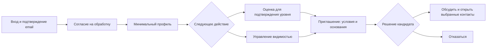

# ФСП · разговор на основании фактов

9 октября 2026. Продуктовая гипотеза и спецификация локальной доработки. Три выбранные UX-доработки реализованы; результаты проверки — в [отчёте](../../validation/visual-polish-2026-10-09/report.md). Исходный аудит и внешние источники — в [research.md](research.md).

**УТП:** «Покажите, что уже умеете. Компания увидит основания для приглашения, а вы — условия до открытия контактов». Для работодателя: «От требований роли к понятному разговору: видно, что подтверждено и что ещё нужно уточнить».

Защищаемая гипотеза отличия — сочетание предметных свидетельств ФСП, оценки, заявленного опыта, конкретной потребности и контроля кандидата. Ни одна отдельная кнопка, обратный найм или сам тест не объявляются уникальными. Человеческая валидизация оценки и реальный ФСП API остаются отдельными незавершёнными условиями.

## Механики и приоритет

| Механика | Новое относительно текущего продукта | Ценность и цена | Решение |
|---|---|---|---|
| Следующее действие по текущему состоянию | Единая рекомендация на главной учитывает активную попытку, приглашения, согласие, профиль, действующий уровень и видимость | Убирает ошибочное предложение пройти тест заново; нужна честная обработка загрузки/ошибки | Реализовать сейчас |
| «Что осталось выяснить» | Краткий итог над уже существующей подробной картой: подтверждённые пункты, условия, обязательные пробелы и дополнительные темы | Работодатель начинает с нерешённых вопросов; это не новый балл и не замена интервью | Реализовать сейчас |
| Приглашение из разбора без повторного ввода | Переносить потребность, кандидата, оплату, нагрузку и выбранные темы из одного ответа API | Не нужно снова собирать предложение; работодатель проверяет поля и явно отправляет | Реализовать сейчас |
| «Один вопрос до контакта» | Кандидат может спросить о конкретном условии без grant | Снижает цену первого ответа, но нынешний диалог требует принятого приглашения. Нужен отдельный ограниченный серверный канал с версиями/антиспамом | Концепт для следующей итерации; текущий диалог не переиспользовать с ослаблением прав |
| Пакет свидетельств под роль | Кандидат выбирает релевантные проекты/подтверждения для одной компании; система показывает область действия и источник | Контекст вместо огромного CV; необходимо отдельное согласие/снимок и отзыв доступа, нельзя автоматически переносить private task solutions | Концепт; проверить спрос до нового API |
| Бюджет проверки | Работодатель заранее показывает план следующего этапа, объём и какие сомнения он проверяет; объясняет, почему имеющихся свидетельств недостаточно | Может сократить дублирующие тестовые задания; нельзя гарантировать отказ всех компаний от интервью | Концепт; шаблон плана и пилот, без санкций/автоматического грейда |
| Намерение и время разговора | Временный статус поиска и выбор слота после согласия | Полезно при активном потоке приглашений; нужны срок актуальности, timezone, отмена и подтверждение | Резерв; не добавлять новые обязательные настройки сейчас |

Последние четыре идеи — наши гипотезы сочетания механик. Ссылки на аналоги подтверждают отдельные подходы, а не уникальность предложений или их эффективность.

## Три проблемы → решения → проверки

1. Кандидату трудно понять актуальное следующее действие. Основание: противоречивые CTA в текущем `CandidateHome`, не пользовательские интервью. Решение: одна функция выбора шага и одинаковые CTA. Проверки: (а) сценарный прогон всех состояний; (б) качественная сессия, где участник без подсказки объясняет следующий шаг и видимость.
2. Работодателю приходится читать подробную карту прежде, чем увидеть предмет разговора. Основание: текущий экран с полным списком проверок и вопросов; ценность свёртки — гипотеза. Решение: короткий итог и подробности по раскрытию. Проверки: (а) одинаковый кейс текущего/нового экрана в чередуемом порядке; (б) участник объясняет, почему выбрал человека и что система не подтверждала.
3. Приглашение из разбора теряет готовые условия. Основание: `CandidateReviewRoute` не передаёт `need` в существующий composer. Решение: перенос данных из одного review response. Проверки: (а) UI сравнивает prefill с API и редактирует сумму до отправки; (б) наблюдение, какие поля работодатель перепроверяет и где замечает отличие от потребности.

## Путь кандидата

Это карта возможных шагов, а не новый обязательный wizard. Публичность доступна без подтверждённого уровня; тест нужен для подтверждения категории. «Один вопрос до контакта» пока отсутствует. Самостоятельное скрытие профиля не предлагается отменить автоматически.

Приоритет главной: активная попытка → известные ожидающие приглашения → согласие на обработку → обязательные поля → проверить приглашения, если их загрузка не завершилась/дала ошибку → оценка при отсутствии уровня → управление видимостью → собственное превью. Активная попытка использует свой срок; переход по ссылке не запускает новый тест. При скрытом профиле CTA «Управлять видимостью», а не обещание публикации. Приглашение не исчезает из пути из-за неполного профиля или желания не проходить тест снова.

Загрузка и ошибка приглашений не выдаются за ноль. Полная анкета сама по себе не означает «виден компаниям»: нужны публичность и актуальные согласия. Подтверждённый уровень не является гарантией найма. Главный CTA и карточка следующего шага должны совпадать; прогресс не выражается процентом «качества человека».

## Путь работодателя

Потребность → явное подтверждение требований → подборка → разбор «что осталось выяснить» → заполненное приглашение → проверка условий и явная отправка → решение кандидата → диалог. Банк без потребности остаётся доступен.

На разборе сначала краткий вывод, затем подробная карта и единые вопросы. Группы: подтверждённые пункты; несовпадающие/неизвестные условия; обязательные навыки, которые только заявлены или неизвестны; дополнительные желательные темы. `met` для формата/нагрузки означает совпадение с заявленными предпочтениями, не независимую валидацию; UI обязан это различать. Любое `mismatch`, отсутствие категории и `excluded` остаются видимыми. Сводка не изменяет серверный `fit.state`, ranking или доступность профиля.

Кнопка подготовки приглашения передаёт need/candidate/topics из одного текущего ответа review. Неизвестность не разрешает называть навык подтверждённым; несовпадение не исправляется автоматически. Дополнительная задача не становится обязательным следующим шагом. Подробные вопросы сохраняются для общего интервью.

## Краевые случаи и приёмка

| ID | Сценарий | Проверяемый результат |
|---|---|---|
| UX01 | Уже подтверждённый публичный кандидат без новых приглашений | Главный шаг не зовёт заново проходить тест; можно посмотреть профиль глазами компании |
| UX02 | Активная попытка и одновременно новое приглашение | Главный шаг продолжает попытку; приглашения остаются видимыми и доступны отдельно |
| UX03 | Приглашение и неполный профиль | Перейти к условиям можно напрямую; принятие остаётся отдельным действием |
| UX04 | Ошибка/загрузка приглашений | Не сообщать «0 приглашений» или «всё выполнено»; показать неизвестность и возможность повторить |
| UX05 | Отозванное согласие или скрытый профиль | Не заявлять публичную видимость только по `visibility`; не принимать согласие автоматически |
| UX06 | Требования совпали, кроме желательного навыка | Не заставлять проходить новый тест и не называть желательный пробел обязательным |
| UX07 | Неизвестный обязательный навык / несовпадающий формат | Разные причины и следующие вопросы; `excluded` не превращается в «подходит» |
| UX08 | Открыт разбор, затем приглашение | Суммы, basis, нагрузка, текст и темы заполнены из этого review; поля редактируемы; сеть не отправляет приглашение до submit |
| UX09 | Меняется адрес разбора / ответ старого запроса запаздывает | Старая форма не переносится другому кандидату/потребности; недоступный профиль не создаёт новый путь к данным |
| UX10 | Мобильная ширина и клавиатура | Подробности раскрываются штатно, фокус виден, основные действия/суммы читаемы |

## Как проверять ценность после поставки

Основной показатель пилота — время от открытия подходящего профиля до корректно подготовленного приглашения, без отправки до решения участника. Дополнительно: успех задачи без помощи; повторно введённые поля; правильное объяснение источника навыка, видимости и последствий принятия. Для кандидата — выбор правильного действия в заранее заданном состоянии.

Базовая величина пока не измерена. Сначала 5 кандидатов и 5 нанимающих специалистов для поиска проблем и качественного сравнения; это не статистическое доказательство конверсии. Порядок интерфейсов чередовать, данные кейсов сопоставимы, наблюдать ошибки понимания и время отдельно. После сессий решить: сохранить, переделать или убрать сводку. Нельзя публиковать «ускорили на X%» из тестов интерфейса или сценарных подсчётов.
